# Escape Plan

A real-time, two-player hide-and-chase game built for the course **2190472 Netcentric Architecture**. One player is the warder and the other is the prisoner. The prisoner wins by reaching the tunnel, and the warder wins by catching the prisoner first. A server-authoritative Python TCP server runs the match; players join from a Tkinter desktop client over TLS (with certificate pinning) or from any browser (including phones) through a WebSocket link.

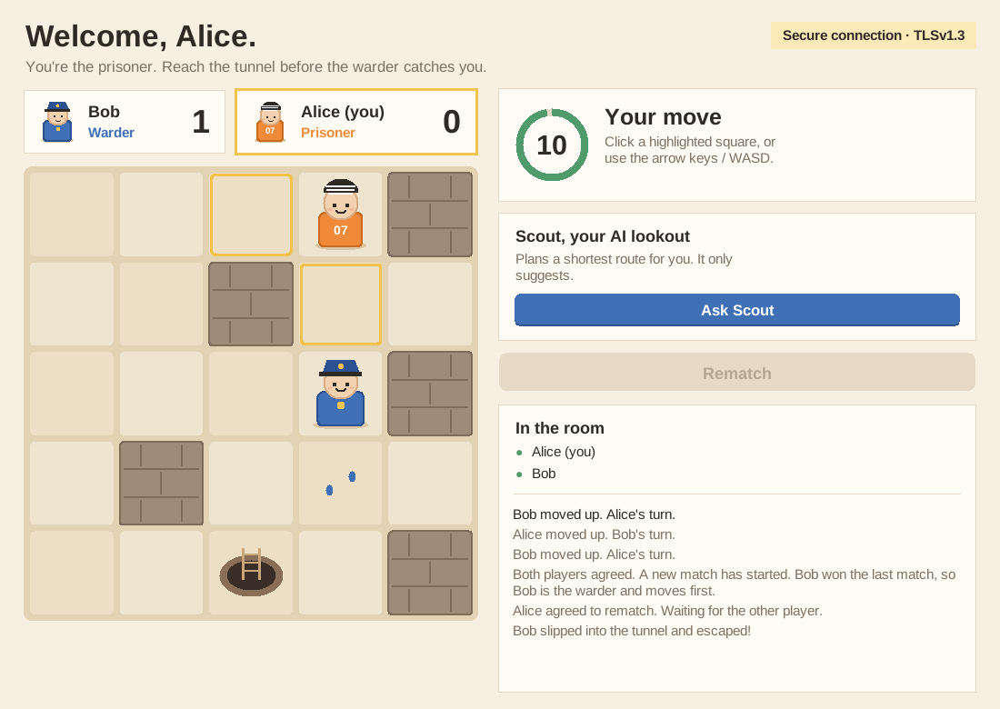

*Screenshots in this README were captured from the real server and clients running under a virtual display, with two scripted Scout-driven players (see "Results and outputs").*

## Contents

1. [Features](#features)
2. [Tech stack](#tech-stack)
3. [Architecture](#architecture)
4. [How it works](#how-it-works)
5. [Results and outputs](#results-and-outputs)
6. [Setup and running](#setup-once-on-every-computer)
7. [Game rules](#how-to-play)
8. [Security](#security)
9. [Remote play, latency and security](#remote-play-latency-and-security)
10. [Balance and tests](#balance)
11. [Repository structure](#repository-structure)
12. [Project Facts (for resume)](#project-facts-for-resume)

## Features

- Two game modes: **Classic** (5x5, the assignment rules) and **Night Escape** (10x10 fog of war, a key, items, lock-on grab, footprints, lockdown).
- Server-authoritative game engine: every move is validated on the server, and each player only receives the part of the state they are allowed to see.
- TLS 1.2+ (TLS 1.3 negotiated here) with certificate pinning (certificate file plus SHA-256 fingerprint check), input size and rate limits, handshake, join and idle timeouts, a connection cap.
- Browser play through a hand-written HTTP + WebSocket (RFC 6455) server on plain sockets, published through a Cloudflare quick tunnel, protected by a secret invite key, an Origin check and strict security headers.
- Lobby with live "who is online" updates, side picking, rematch voting, 10-second turn timer with automatic random step.
- Server dashboard (Tkinter): connected clients, live mini-map, mode switch, reset, swap sides, invite link and QR code.
- Exact game solvers (retrograde analysis) used to deal fair starts, and "Scout", a hint helper built on breadth-first search plus the exact solver.
- Bot-vs-bot balance simulator (`tools/balance.py`) that was used to tune the rules.

## Tech stack

| Area | What is used |
| --- | --- |
| Language | Python 3.9+ (tested here on 3.12), JavaScript and HTML/CSS for the browser client |
| Networking | `socket`, `ssl` (TLS), newline-delimited JSON, hand-written WebSocket framing, `select` |
| Concurrency | `threading` (thread per connection, accept loop, timer loop), `queue.Queue` outboxes, one `RLock` around the game |
| GUI | Tkinter (client and server dashboard), custom canvas drawings in `theme.py` |
| Security | `cryptography` (certificate creation, openssl as fallback), `hmac.compare_digest`, `secrets` |
| Algorithms | Breadth-first search, retrograde game-tree solving, line-of-sight sampling |
| Tools | `cloudflared` (public HTTPS tunnel), `qrcode[pil]` (invite QR code), `pytest` / `unittest` |

## Architecture

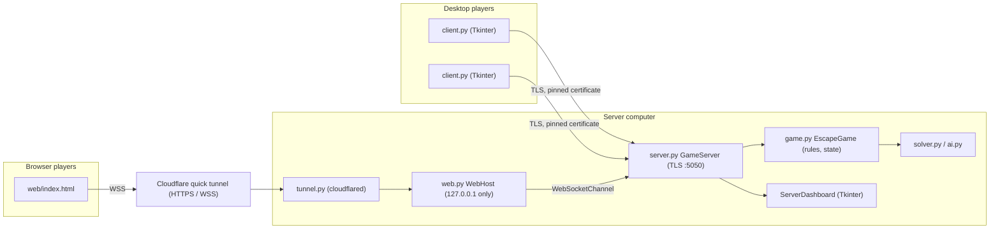

Both transports (TLS socket and WebSocket) expose the same `send / run / close` channel interface (`protocol.Channel` and `web.WebSocketChannel`), so `GameServer` treats desktop and browser players identically.

### Sequence of a match

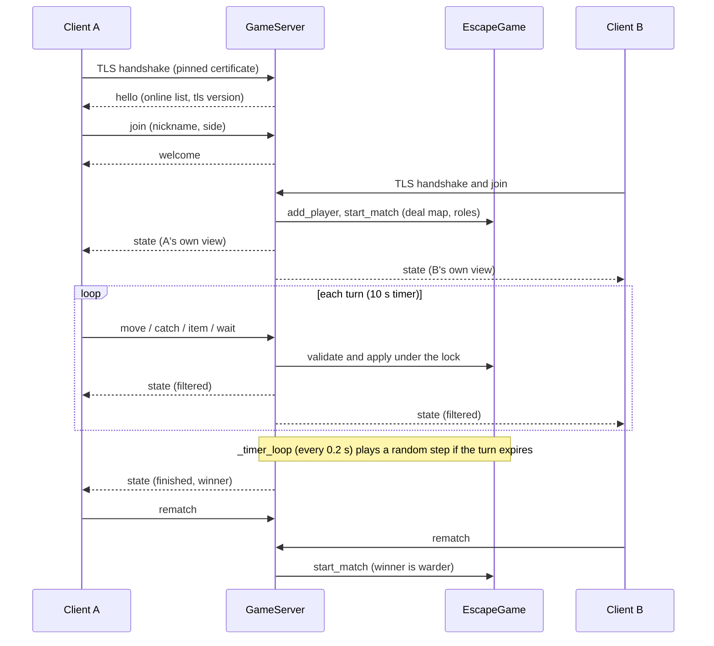

### Protocol

Every message is one JSON object per line (desktop) or one text WebSocket frame (browser). Messages over 4096 bytes are rejected.

| Direction | `type` | Purpose |
| --- | --- | --- |
| client to server | `join` | Choose nickname and preferred side |
| client to server | `move` | Step in a direction (or `stay` to wait in Night Escape) |
| client to server | `catch` | Warder grabs a target square (Night Escape) |
| client to server | `item` | Use an item (searchlight, barricade with target, smoke, sprint) |
| client to server | `side` | Change the preferred side for the next match |
| client to server | `rematch` | Vote for another match |
| client to server | `scout` | Ask the server for a hint (used by browser players) |
| client to server | `quit` | Leave |
| both | `ping` | Keep-alive (desktop client sends one every 15 s; not passed to the game) |
| server to client | `hello` | After connection: who is online, TLS version, whether the room is full |
| server to client | `lobby` | Live online list for people still on the name screen |
| server to client | `welcome` | Nickname accepted |
| server to client | `state` | Full per-player view of the game, plus an optional message |
| server to client | `error` | A request was refused |
| server to client | `scout` | Hint text and suggested direction |

That is 15 distinct message types (8 client requests, 6 server messages, 1 shared keep-alive), plus an internal `invalid` marker for unparsable input.

### Concurrency and synchronization

- **Threads, not asyncio.** `GameServer` runs an accept loop thread, a timer loop thread and one thread per connection (`_serve` runs `Channel.run`). The web host adds its own accept loop and one thread per HTTP/WebSocket connection. The client uses one network thread plus the Tk main loop.
- **One lock for the game.** All reads and writes of `EscapeGame` (moves, joins, leaves, timer expiry, snapshots, dashboard actions) happen inside `GameServer.lock`, an `RLock`. The game engine itself is plain single-threaded code, which keeps it easy to test.
- **One thread owns each socket.** OpenSSL connections must not be read and written by two threads at once. `Channel.run` does both the reading (`select` with a 50 ms tick) and the writing; every other thread only puts encoded messages into the channel's `queue.Queue` outbox. The same design is used for WebSocket connections.
- **Authoritative state sync.** After every accepted change `broadcast()` builds a separate snapshot for each player under the lock (`EscapeGame.snapshot(viewer_id)`), so hidden information (the prisoner in the dark, the key, other player's item boxes) is never sent. A refused move that still changed state (the turn timed out) is also broadcast.
- **Turn timer.** `_timer_loop` wakes every 0.2 s, calls `expire_turn()` under the lock and broadcasts only when the status, the player on turn or the displayed seconds changed.
- **Flood and abuse control.** A token bucket (8 messages per second, burst 16) per connection, 4 KB message limit, idle timeout 45 s, name-screen timeout 90 s, TLS handshake timeout 8 s, and at most 8 simultaneous connections.
- **Client side.** The network thread only pushes messages into a `queue.Queue` inbox; the Tk thread drains it every 60 ms, so the GUI is never touched from another thread. The server dashboard does the same with its event list.

## How it works

1. **Dealing.** Classic maps are generated until a solver check passes (up to 100 tries): every open square reachable, the tunnel has at least 2 entrances, players start an odd walking distance apart and at least 3 steps from each other, and the exact solver (`solver.classic_outcomes`) says neither side has a forced win. Night Escape deals a 10x10 yard, a key with two disjoint routes to the tunnel, and checked boxes.
2. **Turns.** The warder moves first. Each turn lasts 10 seconds; on timeout the server plays a random legal step (never a wait).
3. **Visibility.** In Night Escape the line of sight is computed by `solver.clear_line`, which samples the straight line between square centres and refuses to squeeze between two walls touching at a corner. The server and both clients use the same function for the lantern, the prisoner's view and the red grab zone.
4. **Scout.** `ai.advise` finds a shortest route with BFS. In Classic it ranks each step with the exact solver (take a forced win, avoid a forced loss) and then by walking distance. In Night Escape the prisoner heads for the key, then the tunnel, while staying out of the warder's grab zone; the warder follows footprints. Scout only suggests; it never moves for you.
5. **Balancing.** `tools/balance.py` plays Scout against Scout through the real engine to measure win rates (see Balance).

## Results and outputs

### Server dashboard

The dashboard shows connected clients with their TLS version, the mode switch, the live mini-map of the current match, the event log, and the certificate fingerprint. (The "cloudflared isn't installed" message appears because the tunnel tool was not installed in the capture environment, and the address shown is that environment's.)

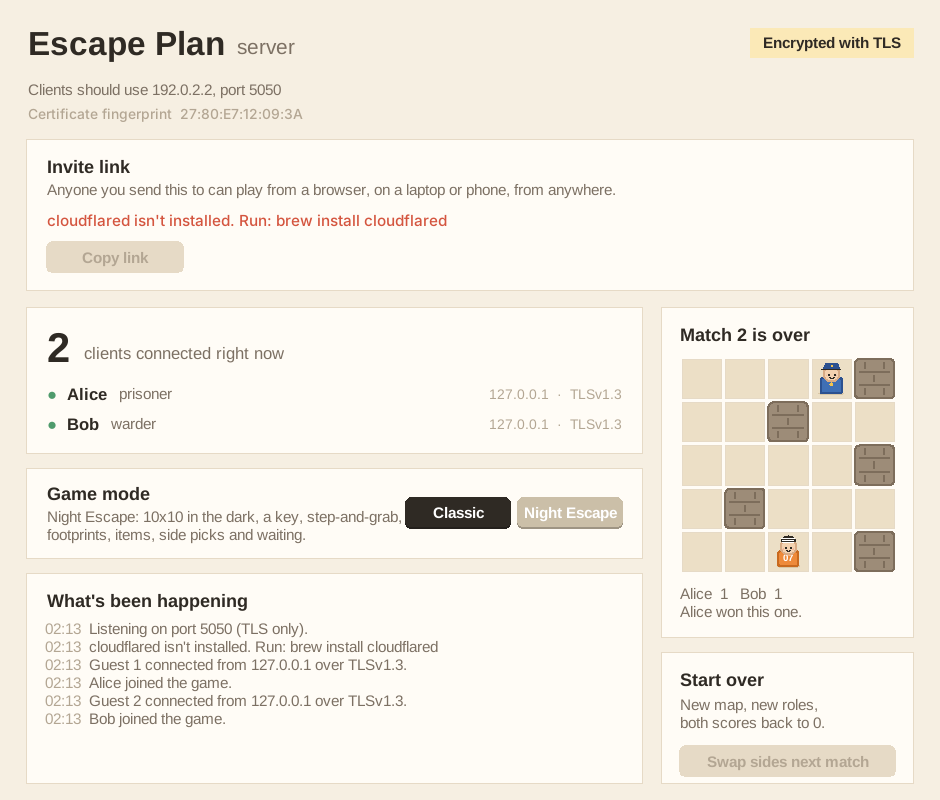

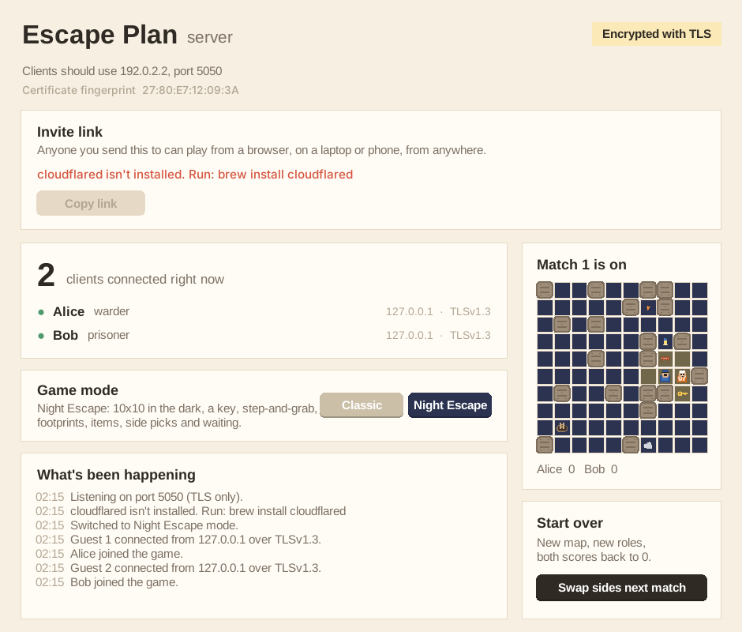

### Lobby / name screen


The browser client is the same game in a web page and also works on a phone:

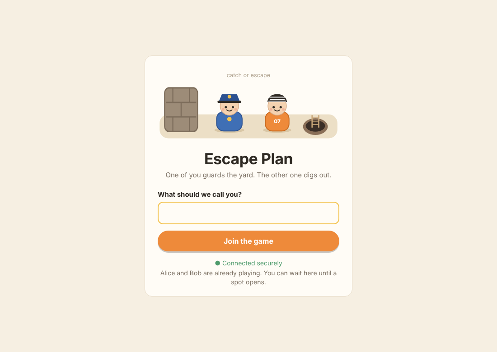

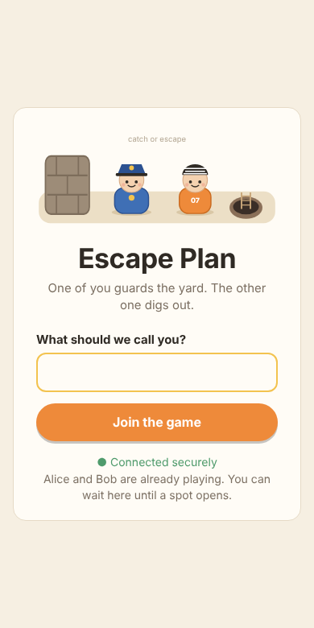

### Classic gameplay and result screens

The animation below is four frames of one captured match (start, two mid-game moves, the result):

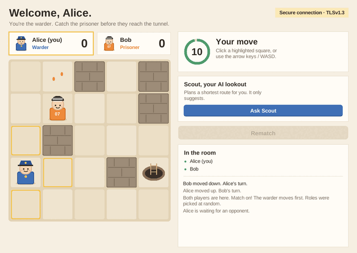

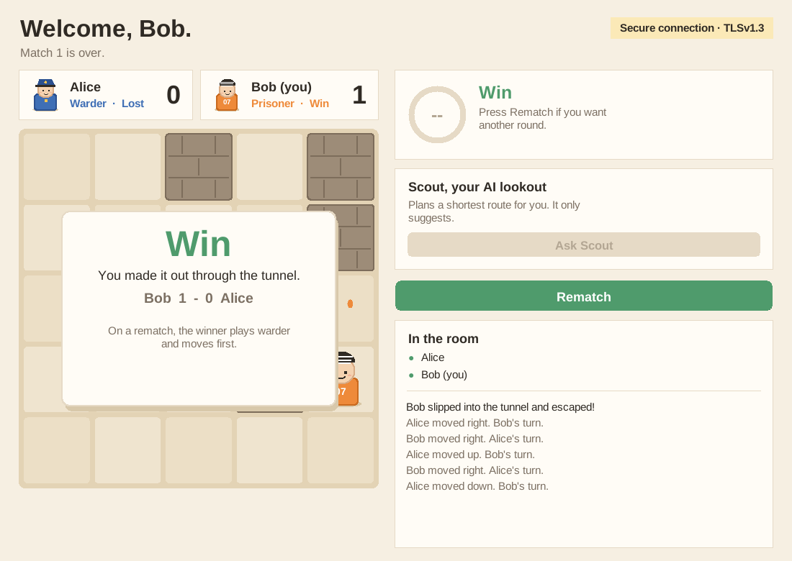

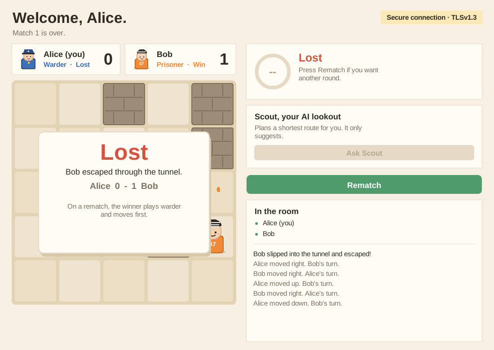

### Night Escape

The warder only sees its lantern (the lit squares) while the prisoner sees the key, the item boxes and a start hint of its own:

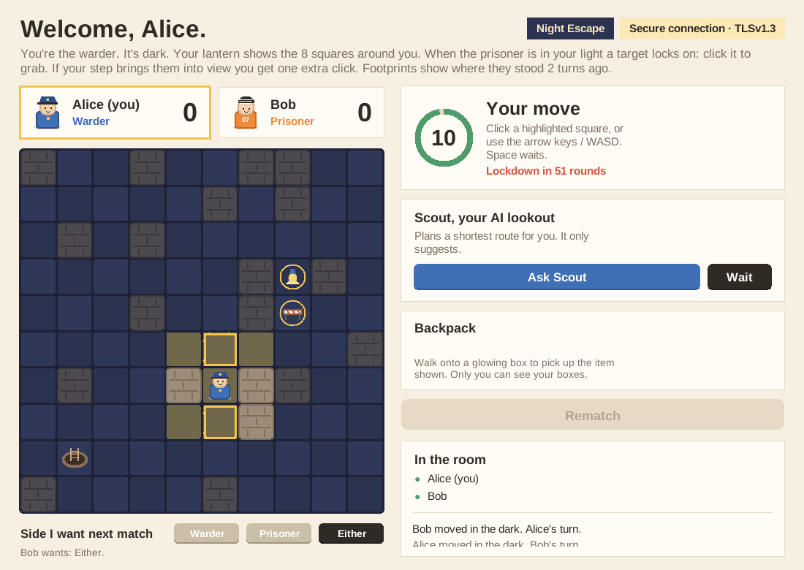

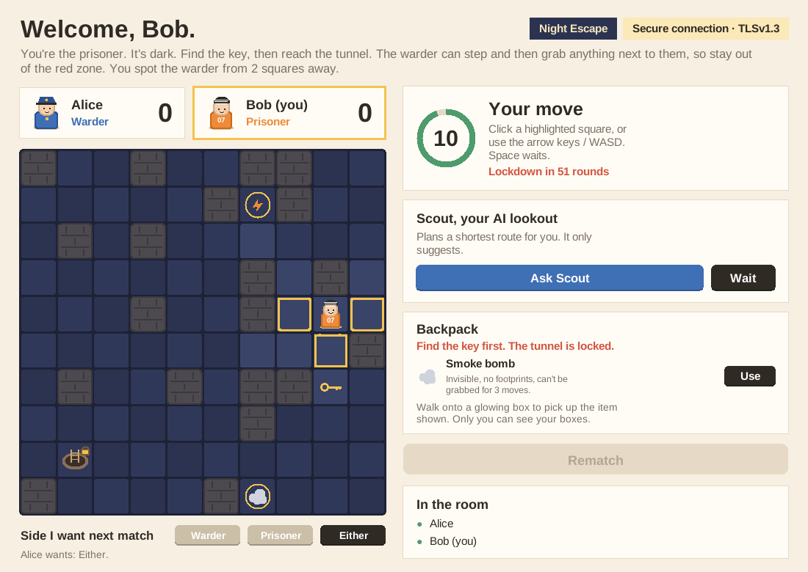

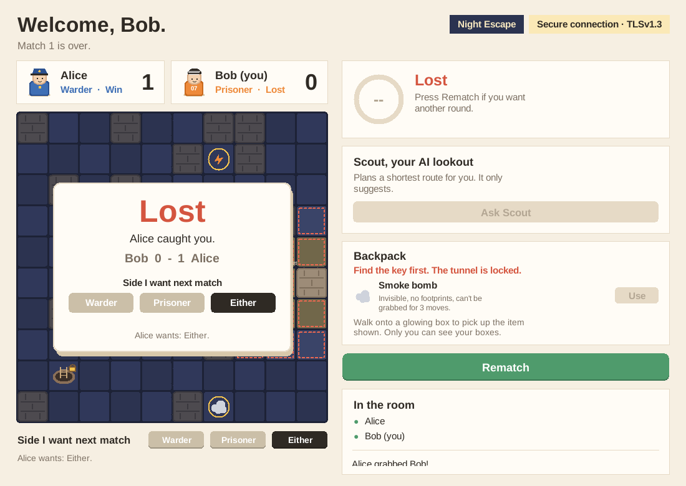

### Test and measurement output

`pytest -q` on the unmodified repository: **130 passed in about 61 s** (Python 3.12, headless machine, `xvfb-run`). Measured on that machine, averaged over 200 seeds: dealing and starting a Classic match takes about 4.7 ms; a Night Escape match about 82 ms (the table below in "Balance" was recorded by the original author on their own machine and says about 3 ms and 39 ms).

## Setup (once on every computer)

The game runs on Windows and macOS. The steps are the same; only the Python command differs: type `python` on Windows and `python3` on macOS.

**1. Install Python 3.9 or newer** from [python.org](https://www.python.org/downloads/). It includes Tkinter, which the game windows need. On Windows, tick **Add python.exe to PATH** in the installer. If you use Homebrew's Python on a Mac, also run `brew install python-tk`.

**2. Install the Python packages** listed in `requirements.txt`. Open a terminal in the project folder and run:

Windows (PowerShell or Command Prompt):

```powershell
python -m pip install -r requirements.txt
```

macOS (Terminal):

```bash
python3 -m pip install -r requirements.txt
```

| Package | What it's for |
| --- | --- |
| `cryptography` | Creates the server's TLS key and certificate on its first run. Without it the server stops with "Can't create a certificate". |
| `qrcode[pil]` | Shows the invite link as a QR code on the dashboard (optional). |
| `pytest` | Runs the tests (optional). |

**Commands at a glance**

| Task | Windows | macOS |
| --- | --- | --- |
| Install the packages | `python -m pip install -r requirements.txt` | `python3 -m pip install -r requirements.txt` |
| Start the server | `python server.py` | `python3 server.py` |
| Start a player window | `python client.py` | `python3 client.py` |
| Install cloudflared (invite link) | `winget install Cloudflare.cloudflared` | `brew install cloudflared` |
| Run the tests | `python -m pytest -q` | `python3 -m pytest -q` |
| Make a new certificate | `python security.py --force` | `python3 security.py --force` |

## Running it

**1. On the server computer**

Start the server: `python server.py` on Windows, `python3 server.py` on macOS.

On the first run it creates `certs/server.key` and a new `certs/server.crt`. The dashboard shows the IP address that clients should use. If your firewall asks whether Python may accept incoming connections (Windows Defender Firewall, or the macOS firewall), allow it, at least on private networks. Otherwise the second computer can't connect.

**2. Set up the second computer**

Copy the project folder to it (or download it from GitHub), then copy `certs/server.crt` **from the server computer** into its `certs` folder. It must be the certificate the server made on its first run: the client refuses any server whose certificate doesn't match its own copy.
**Do not copy `certs/server.key`.** That key stays on the server.

In `config.py`, set `SERVER_HOST` to the IP address shown on the server dashboard. Both computers need to be on the same network.

**3. Start a client on each computer**

Run `python client.py` on Windows or `python3 client.py` on macOS. Type a nickname and press Join. The match starts once two players are in.

If you're testing on one machine, leave `SERVER_HOST = "127.0.0.1"`.

## Invite link: play from any browser

Friends don't need Python or any files. They open a link in their browser and play, on a laptop or a phone, from anywhere.

1. Install the tunnel tool once on the server computer:
   - Windows: `winget install Cloudflare.cloudflared`, then open a new terminal so the command is found.
   - macOS: `brew install cloudflared` (needs [Homebrew](https://brew.sh)).
2. Start the server as usual. After a few seconds the **Invite link** card shows a link like
   `https://some-random-words.trycloudflare.com/#key=...`
   If the page shows "Error 1033" at first, wait up to a minute: the tunnel is still connecting.
3. Click **Copy link** and send it to your friend, or let them scan the QR code (from `qrcode`, which `requirements.txt` installs).

Browser players and desktop (`client.py`) players can play against each other. You get a new link each time the server starts, and the old link stops working.

## How to play

Classic mode follows the assignment's rules exactly:

- The board is 5×5, with 19 open squares, 5 walls and 1 tunnel. Every new match gets a new random map. The server checks that every open square can be reached, so the map is never deadlocked.
- The server picks the roles at random when a match starts. On a rematch, the winner of the last match is the warder.
- The warder always moves first.
- Starts are random but fair. An exact solver checks every Classic start, and neither side may have a guaranteed win from it (with perfect play from both, nobody could force the result). The players start at least 3 walking steps apart (the tunnel counts as a wall for the warder), and the prisoner starts at least 3 walking steps from the tunnel. The players also start an odd number of squares apart: every step changes that distance by one, so from an even distance the warder could never be next to the prisoner on its own turn. Maps where the tunnel has only one way in (the warder could camp on it), or where the tunnel cuts the yard in two, are thrown away and a new map is made.
- You get 10 seconds per turn, and every turn you move one square up, down, left or right. To move, click a highlighted square or use the arrow keys / WASD.
- The warder can't enter the tunnel, and the prisoner can't walk into the warder.
- The winner gets +1. Both players see **Win** or **Lost** and the scores. If both press Rematch, a new match starts with the winner as the warder.
- The server's Reset button starts a fresh match and sets both scores back to 0.

## Night Escape mode

Classic mode is the assignment's game (see above). Night Escape is an extra mode with its own rules, so anything that changes the assignment's game lives here, including picking your side and waiting. Switch between the modes on the server dashboard at any time; switching starts a new match and keeps the scores.

In Classic, a careful prisoner almost always gets away. Night Escape was designed by solving and simulating thousands of games (an exact solver plus bots). Every rule below is there for a reason.

| Rule | How it works |
| --- | --- |
| **Big dark yard** | 10×10 with 20 walls. The warder's lantern lights only the 8 squares around them. The prisoner spots the warder from 2 squares away (one more than the warder). |
| **Walls block sight** | Neither side sees through a wall: the straight line between the two squares' centres must not cross one. Two walls that touch at a corner also block the diagonal between them, so a warder can't see or grab a prisoner round that corner, even under the searchlight. Both clients draw the lantern, the prisoner's view and the red step-and-grab zone with the same rule (`solver.clear_line`). |
| **Key** | The tunnel is locked until the prisoner picks up the key. Only the prisoner can see where it is. (When the warder knew the key's location, they just guarded it.) The key always has two separate ways out: at least 2 open squares next to it, and two routes to the tunnel that share no square, so no single square (the warder or a barricade) cuts it off from the tunnel. That also rules out a tunnel with only one way in. Nor can one warder two squares from the key light every way out with its 3×3 lantern while the key stays dark (`KEY_LANTERN_CHECK`). Before these rules, about a quarter of the keys sat in a dead end or a pocket: the footprints led the warder there, and it waited at the only way out. |
| **Lock-on grab** | When the prisoner is in the warder's lantern light, a target locks onto their square and the warder clicks it to grab them (Q/E/Z/C also grab diagonally). If the warder's step brings the prisoner into view, the warder gets one extra click that turn. If they don't click before the timer runs out, the prisoner slips away. On a board this big the warder almost never caught anyone without this step-then-grab. |
| **Footprints** | The warder sees where the prisoner stood 2 turns ago, anywhere on the map (smoke hides it). Without footprints the warder just camped at the tunnel. |
| **Items** | The prisoner starts every match with a **Smoke bomb**. There are 4 item boxes on the map, 2 per player, and each player only sees their own. Each box shows the item inside: every player gets one box of each of their items. Warder: **Searchlight** (lights the whole yard for 2 warder turns) and **Barricade** (blocks a square within 2 for 3 rounds). Prisoner: **Smoke bomb** (invisible, no footprints, can't be seen for 3 moves) and **Sprint** (2 steps in one turn). |
| **Lockdown** | If the prisoner hasn't escaped after 60 rounds, the prison locks down and the warder wins. |
| **Pick your side** | Choose **Warder**, **Prisoner** or **Either** (the default) under the board or on the Win/Lost card, and see what your opponent picked. A pick takes effect when the next match starts (rematch, mode switch or server reset), never mid-match. Picks that fit together (Warder + Prisoner, Warder + Either, Prisoner + Either) decide the roles. If you both want the same role, the winner of the most recent finished match gets it (a Classic win counts too). Example: you both pick Prisoner and Alex won the last match, so Alex is the prisoner. With no last winner in the room (first match, after a Reset, or the last winner left) it's random. If you both picked Either, the Classic rule decides. Both players are told which rule was used. The server's **Swap sides next match** button sets both picks to the opposite of the current roles. |
| **Waiting** | Instead of moving you can wait (the Wait button or Space). A wait uses up your turn exactly like a move; you just stay on your square. Both sides may wait. `ALLOW_WAIT = False` in `game.py` turns it off. A prisoner's wait ends their turn like a step: it leaves a footprint, counts down smoke, counts toward the lockdown, ticks barricades and ends a sprint. A warder's wait never gives the step-and-grab extra click (that only follows a step). A wait the other side can't see is announced and sent exactly like a move in the dark, so the network messages don't give it away. |
| **Fair deals** | The warder starts at least as close to the tunnel as the prisoner, but never right next to it. An exact game-tree solver (`solver.py`, with waiting for both sides) rejects any deal where the prisoner could escape by force. |
| **Start hint** | When the prisoner's first turn begins (after the warder's opening move), the prisoner sees a red 3×3 block labelled "Warder is somewhere here". The warder is in it, but not always in the middle: the block is picked at random once per match (and slides inward at the edges), so it can't be narrowed down by comparing updates. It stays as a faded "last known area" for one more turn (`START_HINT_TURNS`). Only the prisoner's view carries it, never the warder's exact square, and Scout plans the prisoner's route around it. |

Both sides' views are filtered on the server. The warder never receives the prisoner's position or the key while it's dark, and the prisoner never receives a warder who is out of sight. Moves in the dark are announced without a direction, so a modified client can't cheat by reading network traffic.

**Timeouts (both modes):** if a player doesn't move within 10 seconds, they take a random legal step, never a wait, so going idle isn't rewarded. A prisoner's random step avoids the lantern when it can.

## Security

Everything goes over TLS (1.2 or newer; on current Python it negotiates TLS 1.3).

- **Encryption:** someone else on the same Wi-Fi can't read or change the moves or nicknames.
- **Server identity (certificate pinning):** the client only trusts the exact certificate in `certs/server.crt`. It also checks the SHA-256 fingerprint after the handshake. A fake server that doesn't have `server.key` is rejected, even if it uses the same IP address. The first few bytes of the fingerprint appear on the server dashboard, so you can compare them.
- **Plain TCP is refused:** a connection that doesn't complete a TLS handshake within 8 seconds is dropped.
- **Input limits:** messages over 4 KB, more than 8 messages per second, unknown commands, invalid directions and unknown sides are all rejected. Nicknames are cleaned (no control characters, max 16 characters, no duplicates).
- **Timeouts:** the server disconnects clients that don't pick a name within 90 seconds or stay silent for 45 seconds. Clients send a small keep-alive every 15 seconds. At most 8 connections are allowed at once.
- **Server-side rules:** the server checks every move. A modified client can't teleport or move out of turn.

**Invite link security**

- **Real HTTPS:** Cloudflare provides a real HTTPS certificate, so browsers show a padlock and no warning.
- **Nothing opened to the internet:** the web part of the server only listens on `127.0.0.1`. `cloudflared` makes an outgoing connection to Cloudflare, so there's no port forwarding and no firewall hole. A secure WebSocket (`wss://`) carries the game.
- **Secret invite key:** the link ends in a random key that changes every time the server starts. Browsers without the key are refused (HTTP 403). The key is in the `#` part of the link, so it isn't sent when the page loads and never appears in a Referer header.
- **Blocks other websites:** a page on another site can't open a game connection (the `Origin` header is checked).
- **Only one file served:** the web server serves only the game page. Any other path gets a 404, so nothing else in the folder can be downloaded.
- **Locked-down page:** strict security headers (Content-Security-Policy, no framing, no referrer). Nicknames are inserted as plain text, so a name like `<script>` can't run code.
- **Same checks for everyone:** browser players get the same size limits, rate limits and server-side move checks as desktop players.

To make a new certificate (for example after `server.key` has leaked), run:

```bash
python security.py --force     # Windows
python3 security.py --force    # macOS
```

After that, copy the new `certs/server.crt` to the clients again.

## Remote play, latency and security

This section describes what the code in `tunnel.py`, `web.py`, `protocol.py`, `security.py` and `server.py` does for browser play over a Cloudflare tunnel, for lag and dead connections, and for security. Everything below was read from the code; there are no load tests or latency measurements in the repository.

### Cloudflare tunnel (remote play)

- `tunnel.py` starts `cloudflared tunnel --no-autoupdate --url http://127.0.0.1:<web port>` as a subprocess (a Cloudflare *quick tunnel*, no account or domain configured in the code). It reads the process output and picks out the first `https://<random>.trycloudflare.com` address with a regular expression.
- The tunnel exposes only the browser web server (`web.py`, default port `WEB_PORT = 5051` in `config.py`, bound to `127.0.0.1`). The desktop TLS game port (`SERVER_PORT = 5050`) is not part of the tunnel.
- If `cloudflared` is not installed, or the process exits with an error, `tunnel.py` reports it to the dashboard (the Invite link card shows the problem); `stop()` terminates the process, and kills it if it has not exited after 3 seconds.
- The server dashboard builds the invite link as `<public url>/#key=<secret>` and shows it as text and a QR code (`server.py`).

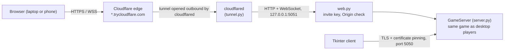

### Latency and connection health

The game is turn based, so the code handles lag with timers and keep-alives rather than prediction or interpolation:

- **Server-authoritative state:** the server validates every move and sends each player a fresh state snapshot after each change. There is no client-side prediction, interpolation or buffering of moves.
- **Turn clock:** each turn is `TURN_SECONDS = 10` (`game.py`). A timer thread in `server.py` wakes every 0.2 s, expires overdue turns (random legal step) and broadcasts when the turn, status or the remaining whole seconds change, so clocks update about once per second.
- **Clock smoothing on the clients:** the snapshot carries `turn_seconds_left`. `client.py` and `web/index.html` run their own local countdown (100 ms tick in Tkinter, animation timer in the browser) and only re-sync it when it drifts more than 1 second from the server value or the turn changes.
- **Keep-alives:** the desktop client sends a `ping` every 15 s (`PING_EVERY`) when it has been quiet; the server sends a WebSocket ping frame to browsers every 15 s, which also keeps the tunnel from treating the connection as idle. Browsers answer automatically; the server also answers client pings with pongs.
- **Dead connections:** the server closes a connection that has sent nothing for 45 s (`IDLE_LIMIT`), a client that has not chosen a nickname within 90 s (`JOIN_TIMEOUT`), and a connection whose TLS handshake takes longer than 8 s (`HANDSHAKE_TIMEOUT`). The desktop client opens its connection with an 8 s connect timeout (`open_tls`) and 10 s socket timeout.
- **Non-blocking sends:** each connection runs in one thread; other threads only put messages into an outbox queue, so a slow client does not block game logic or other players (`protocol.py`, `web.py`).
- **After a drop:** neither client reconnects automatically. They show a "Lost the connection" message; the browser's **Reconnect** button reloads the page, and the desktop client has a retry button for the first connection.
- **Not in the code:** round-trip time is not measured or displayed anywhere.

### Security measures

| Area | What the code does | Where |
| --- | --- | --- |
| Transport encryption | TLS 1.2 or newer on the desktop port; plain TCP is refused. Browsers use HTTPS/WSS through Cloudflare. | `security.py`, `server.py` |
| Server identity | Self-signed ECDSA P-256 certificate (365 days, `serverAuth`, not a CA); clients trust only that certificate and also compare its SHA-256 fingerprint after the handshake. `server.key` is created locally with mode `0600` and is git-ignored. | `security.py`, `.gitignore` |
| Invite key | `secrets.token_urlsafe(12)` created per server start, passed in the URL fragment, checked with `hmac.compare_digest` on the WebSocket upgrade; a wrong key gets HTTP 403. | `web.py` |
| Origin check | A WebSocket upgrade is refused unless the `Origin` host equals the `Host` header. | `web.py` |
| Minimal web surface | Listens on `127.0.0.1` only, serves only `/` (and `/index.html`) and `/ws`, other paths return 404; request headers are capped at 8 KB. | `web.py` |
| Response headers | Content-Security-Policy (`default-src 'none'`, `frame-ancestors 'none'`, ...), `X-Content-Type-Options`, `X-Frame-Options: DENY`, `Referrer-Policy: no-referrer`, `Cache-Control: no-store`. | `web.py` |
| Message limits | Messages over 4096 bytes close the connection; a token bucket allows 8 messages per second with a burst of 16 (`MESSAGES_PER_SECOND = 8`); browser frames must be masked, text, unfragmented and under 4096 bytes. | `security.py`, `protocol.py`, `web.py`, `server.py` |
| Input validation | Invalid JSON becomes an `invalid` message; unknown message types, move directions and sides are rejected; a player must join before doing anything else; moves are validated by the server. | `protocol.py`, `server.py`, `game.py` |
| Nickname sanitising | Unicode-normalised, control characters removed, spaces squashed, length capped, duplicates refused; the browser inserts names as plain text, not HTML. | `game.py`, `web/index.html` |
| Connection cap | At most `MAX_CONNECTIONS = 8` simultaneous connections, for desktop and browser clients combined. | `server.py` |
| Hidden information | Each player only receives the part of the state they may see, so network traffic does not reveal the other side. | `game.py`, `server.py` |
| Logging | Refused browsers are logged with the Cloudflare `CF-Connecting-IP` header when present. | `web.py` |

Related tests: `test_network.py` (plain TCP refused, oversized message disconnects, wrong certificate refused, hidden information) and `test_web.py` (security headers, only the page is served, wrong key refused, other websites refused). I could not run the test suite in this environment (collection errors), so these are listed from reading the test code.

## Extra features

| Feature | AI? |
| --- | --- |
| Scout: a breadth-first-search hint that shows the best next square on the board. In Night Escape it also tells you to wait when staying put is best, plans around the grab zone, and a warder who can't see follows the footprints. Browser players get the same hint from the server (`ai.py`), computed only from their own view. | ✓ |
| Night Escape: wait instead of moving (button or Space) | |
| Exact game-tree solvers that deal only fair starts (no forced wins) in Classic and Night Escape | ✓ |
| Scout in Classic: ranks every step with the exact solver (take a forced win, avoid a forced loss), then by walking distance | ✓ |
| Night Escape mode: 10×10 fog of war for both sides, with server-side hidden information | |
| Night Escape: secret key that unlocks the tunnel | |
| Night Escape: step-and-grab + footprints | |
| Night Escape: private item boxes that show their item (Searchlight, Barricade, Smoke bomb, Sprint), and a starting Smoke bomb for the prisoner | |
| Night Escape: 60-round lockdown | |
| Night Escape: the prisoner's start hint (a 3×3 block holding the warder) | |
| Random step when a player's 10 seconds run out | |
| TLS encryption with certificate pinning | |
| Public invite link: play in any browser, even on a phone, via a secure tunnel | |
| Click-to-move with highlighted legal squares | |
| Lobby: see who's online before joining, with live updates | |
| Night Escape: choose your side (Warder, Prisoner or Either), see your opponent's pick, swap sides from the server dashboard | |
| Server dashboard with a live mini-map of the current match | |
| Fair random starting positions | |
| Countdown ring timer, footprints showing the last move, and a Win/Lost card | |
| "Try again" reconnect button if the server goes down | |

## Balance

`python tools/balance.py` (`python3` on macOS) plays Scout against Scout through the real game engine. Each bot sees only its own view, and 15% of the moves are random so the bots make mistakes. The numbers are the warder's share of the games that finished.

| Classic | Bots' Scout | Warder |
| --- | --- | --- |
| Before: must move, straight-line distance starts | breadth-first only | 42% |
| Waiting allowed, same starts | breadth-first only | 49% |
| Waiting allowed, same starts | with the solver | 43% |
| + solver-checked starts (no guaranteed wins) | with the solver | 60% |
| + walking distances, no maps split by the tunnel | with the solver | 60% |
| + at least 2 ways into the tunnel | with the solver | 58% |
| Same rules, but must move (no waiting in Classic, as the assignment says) | with the solver | 24% |
| + the players start an odd number of squares apart (**final**) | with the solver | **63%** |

Waiting was tried in Classic first (the rows above that allow it), but the assignment says every turn is a step to an adjacent block, so Classic doesn't allow it any more and waiting is a Night Escape rule. With the old starts, 40% of Classic starts were a guaranteed prisoner win and 9% a guaranteed warder win (with waiting allowed; 40% and 32% without). The final rules hold at 60-64% across 5-25% random moves. The breadth-first Scout made a poor prisoner (it walked right next to the warder), so with solver-checked starts it handed the warder 63%. That's why Scout's Classic advice now uses the solver for both sides.

Two rules were tried and dropped. "The warder can reach a square next to the tunnel no later than the prisoner reaches the tunnel" changed nothing, because the solver check already rules those starts out. Capping the prisoner's walk to the tunnel at 4-5 steps moved the result by about 1%. Requiring 3 ways into the tunnel gives 56%, but it throws away about 40% of maps; `MIN_TUNNEL_ENTRANCES` in `game.py` sets it.

Without waiting, solver-checked starts alone don't fix the balance: the distance between the players changes by exactly 1 every move, so on an even distance the warder can never be next to the prisoner on its own turn. 80% of the solver-checked starts had an even distance. Dealing only odd distances fixes that. Only about 1 map in 5 has such a start, so dealing tries up to 100 maps (`CLASSIC_DEAL_TRIES`); a deal still takes about 3 ms.

| Night Escape (bots also use items) | Warder |
| --- | --- |
| Before waiting and the start hint | 87% |
| With waiting and the start hint | 86% |
| + the key has two separate ways out (6,000 games) | 85.5% |
| + no single lantern spot watches both (6,000 games) | 84% |
| + walls block sight and grabs, Scout's exact red zone (**final**, 6,000 games) | **78%** |

Of the keys the old deal picked, 26% had a dead end (6%) or a single square that cut them off, and another 18% could be watched from one lantern spot. Dealing now throws away about 1 map in 8 (the tunnel itself is cut off, so no key spot passes) and takes about 39 ms instead of 35.

These Night numbers say more about the bots than the rules. Scout's night prisoner doesn't remember where it last saw the warder, so it walks into the dark. Even with no random moves at all it loses 84%. With the step-and-grab removed entirely the warder still wins 81% of bot games. Night Escape needs a smarter prisoner bot, or real playtests, before its rules are tuned further.

## Tests

```bash
python -m pytest -q     # Windows
python3 -m pytest -q    # macOS
```

Waiting has its own tests (`test_wait.py`, plus more Night cases in `test_night.py`): Classic refuses a wait, and in Night Escape a wait passes the turn without moving, can't be done out of turn, can be switched off with `ALLOW_WAIT`, leaves footprints, counts down smoke and counts toward the lockdown. A hidden wait produces exactly the same real network messages as a move in the dark. `test_solver.py` checks both solvers on positions you can work out by hand. The fair-start test checks over many seeds that no Classic start is a guaranteed win for either side and that the players start an odd distance apart. The start-hint tests check that only the prisoner gets the 3×3 block, that it holds the warder (not always in the middle), stays put and disappears on time, and that the prisoner's real messages never carry the warder's square. The key tests check over many seeds that the key has at least 2 open neighbors, that blocking any single square never cuts it off from the tunnel, that no lantern spot two from the key watches every way out, and that dealing a Night match stays quick. The sight tests check `clear_line` on hand-drawn cases (two walls at a corner, a wall in a straight line, a knight's jump) and that it works the same both ways, and that the game refuses a grab round a walled corner (also after a step, in smoke and under the searchlight) and hides each side behind walls.

The tests cover the game rules, Scout, and real TLS connections on localhost. The Classic role tests check that roles are random whatever the players picked, and that on a rematch the winner is the warder and moves first. The Night Escape side-picking tests cover every combination of picks, the random and last-winner fallbacks, and that a change waits for the next match. The TLS tests check that two players can join and play, that a Classic rematch makes the winner the warder, that side picks travel both ways and bad ones are refused, that moves out of turn are refused, that plain TCP and oversized messages are rejected, and that the client refuses a server with the wrong certificate. The Night Escape tests cover:
- what each role can see
- the key and the locked tunnel
- the lock-on grab and the extra click after a step
- footprints
- all four items, private boxes and the lockdown
- random steps on timeout, and fair dealing (checked against the solver)
- Scout's night advice
- that neither side's real network messages leak hidden positions

There are also browser-side tests: a wrong invite key or another website's origin gets a 403, only the game page is served, and a browser player can join, get the game state and pick a side.

## Repository structure

```text
.
├── server.py          GameServer (TLS listener, sessions, broadcast, timer) + Tkinter ServerDashboard
├── client.py          Tkinter player client (name screen, board, timer, Scout, rematch)
├── game.py            EscapeGame: rules, dealing, turns, visibility, items, scores
├── solver.py          Exact solvers (retrograde analysis) and line-of-sight (clear_line)
├── ai.py              Scout hint helper (BFS + exact solver)
├── protocol.py        Channel: JSON lines over TLS, one thread per connection, token bucket
├── security.py        Certificate creation, pinning, TLS contexts, limits
├── web.py             HTTP + WebSocket server on plain sockets, invite key, Origin check
├── web/index.html     Browser client (HTML, CSS, JavaScript in one file)
├── tunnel.py          Starts cloudflared and reads the public URL
├── theme.py           Colors, fonts, rounded buttons, character drawings (Tkinter canvas)
├── config.py          Server host and ports
├── tools/balance.py   Bot-vs-bot balance simulation (not run by the tests)
├── test_*.py          7 test modules (game, night, wait, solver, ai, network, web)
├── certs/server.crt   Public certificate only (server.key is created on first run and git-ignored)
├── docs/images/       Screenshots and the GIF used in this README
└── requirements.txt   cryptography, qrcode[pil], pytest
```

## Project Facts (for resume)

Plain facts, each one checked against the code, the test run or a measurement made while writing this README.

**Course and context**

- Course: 2190472 Netcentric Architecture (from the repository name).
- The README says Classic mode "follows the assignment's rules exactly"; the assignment text itself is not in the repository.

**Team and contribution**

- Solo or team project: team.
- My contributions: Cloudflare tunnelling for remote play, latency handling and security. In the code these areas are `tunnel.py` (cloudflared quick tunnel), `web.py` (invite key, Origin check, security headers, WebSocket limits), `security.py` (TLS certificate, pinning, message size limit), `protocol.py` (keep-alives, idle timeout, rate limiting) and the timeout/connection-limit parts of `server.py`. Details are in "Remote play, latency and security". The git history has a single commit ("Import Escape Plan project files"), so it cannot show who wrote which part; these areas are as stated by the project owner.

**Languages, frameworks, libraries**

- Python (standard library: `socket`, `ssl`, `threading`, `queue`, `select`, `json`, `hmac`, `hashlib`, `secrets`, `subprocess`, `dataclasses`, `tkinter`), plus `cryptography`, `qrcode[pil]`, `pytest`.
- JavaScript, HTML and CSS (single file `web/index.html`, no framework or build step).
- External tool: `cloudflared` (Cloudflare quick tunnel).

**Size (measured with `wc -l` on tracked files; 24 tracked files)**

| Part | Lines |
| --- | --- |
| Python application code (11 files: server, client, game, ai, solver, protocol, security, web, tunnel, theme, config) | 4,642 |
| Python tests (7 files) | 1,754 |
| Python tool (`tools/balance.py`) | 140 |
| Python total | 6,536 |
| Browser client `web/index.html` | 899 (about 589 JavaScript, 310 HTML/CSS) |

- Message types: 15 distinct (8 client requests, 6 server messages, 1 shared `ping`).
- Tests: 130 test functions in 7 modules (`test_night` 59, `test_game` 29, `test_solver` 13, `test_network` 12, `test_web` 7, `test_wait` 6, `test_ai` 4). Result of `pytest -q` here: 130 passed in about 61 s.

**Key features**

- Server-authoritative multiplayer game with per-player filtered state (hidden-information handling).
- TLS with certificate pinning for desktop players; WebSocket (hand-written RFC 6455) plus invite key, Origin check and security headers for browser players.
- Two modes (Classic 5x5, Night Escape 10x10) with items, key, fog of war, lockdown, side picking, rematch.
- Fair-start dealing using exact solvers; Scout hint helper; server dashboard; balance simulator.

**Algorithms and design patterns**

- Breadth-first search for routes and distances (`ai.py`, `game.py`).
- Retrograde analysis (backward induction over all positions) for exact win/lose labels (`solver.classic_outcomes`, `solver.prisoner_forced_wins`).
- Line-of-sight by sampling at odd multiples of 1/d (`solver.clear_line`), shared by server and clients.
- Token-bucket rate limiting (`protocol.Channel._allow`, `web.WebSocketChannel._allow`).
- Producer/consumer queues for outgoing messages and GUI events; a single lock around authoritative state; one thread owns each socket.
- Common channel interface for two transports (TLS socket, WebSocket); server-authoritative state with per-viewer snapshots; `lru_cache` on the Classic solver table in `ai.py`.
- Certificate pinning (trust one certificate file and re-check its SHA-256 fingerprint).

**Measurable numbers**

| Item | Value | Source |
| --- | --- | --- |
| Players per match | 2 (one shared game on the server) | `game.py`, `server.py` |
| Simultaneous connections | at most 8 (players plus people on the name screen) | `MAX_CONNECTIONS` in `server.py` |
| Concurrent matches | 1 (a single shared `EscapeGame`) | `server.py` |
| Turn time | 10 s | `TURN_SECONDS` |
| Server timer loop | every 0.2 s | `_timer_loop` |
| Connection loop select tick | 50 ms | `protocol.py` |
| Client GUI inbox drain | every 60 ms | `client.py` |
| Keep-alive | client ping every 15 s, server idle limit 45 s | `protocol.py` |
| Rate limit | 8 messages per second (burst 16), max message 4,096 bytes | `server.py`, `security.py` |
| Timeouts | TLS handshake 8 s, name screen 90 s | `server.py` |
| Board sizes | Classic 5x5 (5 walls), Night 10x10 (20 walls), lockdown after 60 rounds | `game.py` |
| Deal + start time (measured here, mean of 200 seeds) | Classic about 4.7 ms, Night about 82 ms | measured |
| Exact Classic solver, one sample 5x5 map (measured here) | about 1 ms per solve, 487 forced-outcome positions | measured |
| Bot-vs-bot warder win rate, Classic, final rules | 63% | Balance table (author's recorded run) |
| Bot-vs-bot warder win rate, Night Escape, final rules | 78% over 6,000 games | Balance table (author's recorded run) |
| Classic starts that were forced wins with the old dealing | 40% prisoner, 9% warder (waiting allowed) | Balance section (author's recorded run) |
| Night keys that were dead ends or single-cut before the fix | 26%, plus 18% watchable from one lantern spot | Balance section (author's recorded run) |

I did not re-run `tools/balance.py`; the balance numbers are the ones recorded in this README by the project author.

**Hard problems and how they were solved**

- *Hidden information over the network.* Each player gets a separate snapshot built on the server, and moves in the dark are announced without a direction; tests (`test_network`, `test_night`) check that real messages never carry the hidden position.
- *Thread safety with TLS sockets.* A single thread reads and writes each socket and other threads use an outbox queue; game state sits behind one `RLock`; the Tk GUI is fed only through queues.
- *Unfair or lopsided games.* Dealing was changed repeatedly and checked with solvers and bot simulation (see the Balance table), including the parity argument that an even starting distance makes a catch impossible.
- *Keys the warder could just camp.* The dealer requires two separate routes from the key to the tunnel and rejects keys that one lantern spot can watch.
- *Browser support without extra dependencies or open ports.* WebSocket framing written by hand; the web server listens on 127.0.0.1 only and is published through an outgoing Cloudflare tunnel with a secret key kept in the URL fragment.
- *Authenticating the server without a public CA.* Certificate pinning with a fingerprint check.

**Outcome**

- The project runs end to end (server, desktop clients, browser client) and all 130 tests pass in the environment used here.
